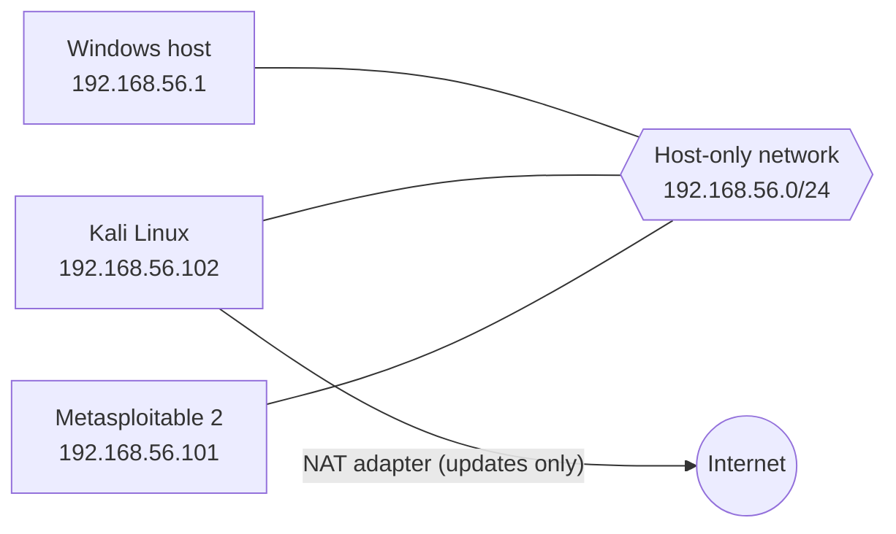
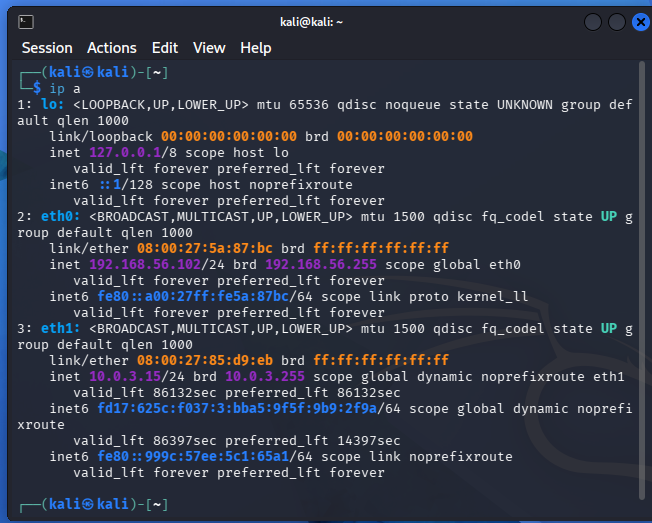
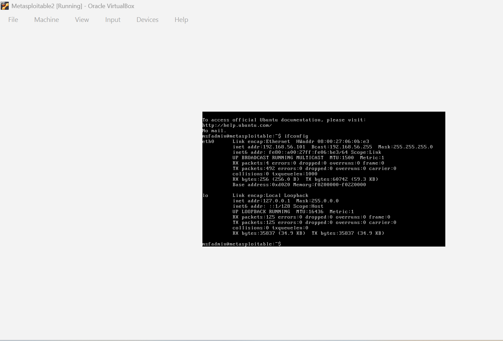
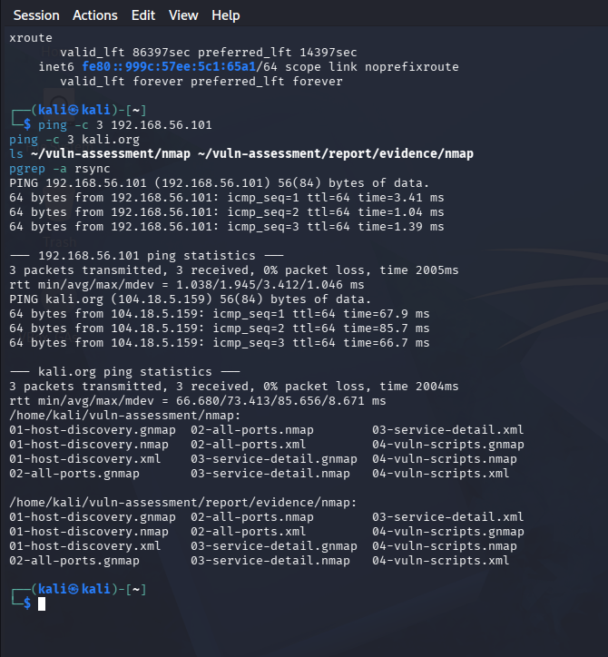
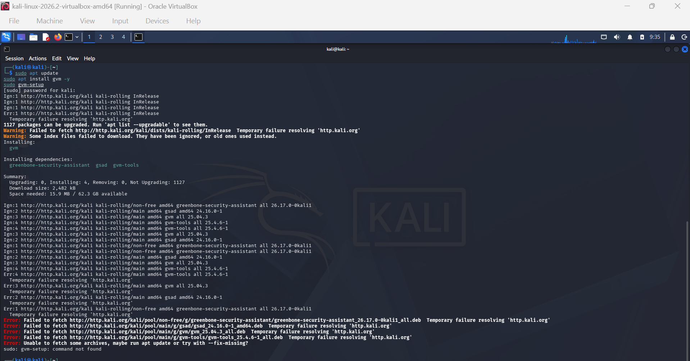
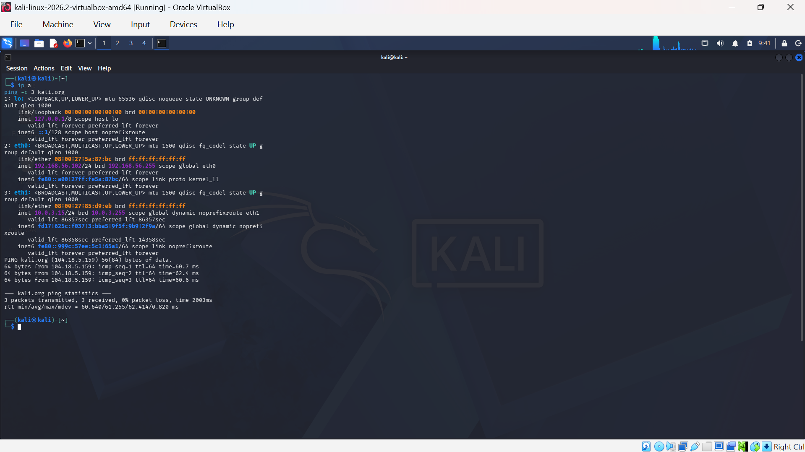

# Home Lab: Kali Linux + Metasploitable 2

## What this is

A small lab for practicing on a deliberately vulnerable machine. Running on a Windows host with 8GB RAM, using VirtualBox. The target is never reachable from outside my computer and has no route to the internet.

| | Kali Linux | Metasploitable 2 |
|---|---|---|
| Role | Attacker and scanner | Target |
| OS | Kali Linux 2026.2 | Ubuntu 8.04 based (end of life since 2013) |
| Resources | 4GB RAM, 2 CPUs | 512MB RAM |
| Network adapters | 1: Host-only. 2: NAT (updates and downloads only) | 1: Host-only, nothing else |
| IP address | 192.168.56.102 (static, host-only) | 192.168.56.101 (static) |










## How the lab changed

The lab started as a fully isolated Internal Network and has changed since. I've kept both versions here, because the troubleshooting from the original build is still the part I learned most from.

| | Original build | Now |
|---|---|---|
| Network | VirtualBox Internal Network ("labnet") | VirtualBox Host-only network, 192.168.56.0/24 |
| Kali | 2GB RAM, no internet | 4GB RAM, 2 CPUs, plus a NAT adapter for updates |
| Metasploitable 2 | 1GB RAM | 512MB RAM |
| Internet | None for either VM | Kali only, through the NAT adapter. Metasploitable has none |
| Host access | None | The host can reach both VMs. I used that to copy scan results out of Kali |

I went with an internal network instead of NAT or bridged mode on purpose. Metasploitable is full of unpatched vulnerabilities by design, so I didn't want it reachable from anywhere outside the lab, or able to reach out either.

That still holds for the target. It was the attacker box that needed a way out, because installing OpenVAS means downloading its tools and vulnerability feeds.

## Setting it up (original build)

I already had Kali running as a VM (2GB RAM). Metasploitable was a bit different to get going, it doesn't come as an OVA you can just import like Kali does. It's a zipped VMDK file, so I had to create a new VM manually in VirtualBox and point it at the extracted disk file instead of using the usual import wizard. Gave it 1GB RAM since it's old and doesn't need much.

Set both VMs' network adapters to Internal Network, and made sure the network name was typed identically on both ("labnet"). Found out the hard way that this is case sensitive, if the names don't match exactly, VirtualBox just silently creates two separate networks instead of connecting the machines.

## What went wrong (and how I fixed it)

This ended up being the most useful part, honestly. Documenting it here because working through it taught me more than the setup itself did.

**No IP address after booting either VM.** Turns out Internal Network mode in VirtualBox doesn't run DHCP, unlike NAT or Bridged mode. Nothing hands out addresses automatically, so both machines needed a static IP set by hand.

**ifconfig said it worked but nothing actually changed (on Kali).** I ran the standard `ifconfig eth0 <ip> netmask <mask> up` command, no error came back, but checking with `ip a` afterward showed the interface still had no address. Switched to the newer `ip` command instead:
```
sudo ip addr add 192.168.56.102/24 dev eth0
sudo ip link set eth0 up
```
That one actually stuck.

**"Network is unreachable" when I tried to ping.** This happened before Kali's interface was properly up. Useful to know in hindsight, that specific error means the problem is on your own machine's interface, not the target or the path to it.

**Then "destination host unreachable" once Kali was fixed.** Different error, different meaning, this one pointed at the other end not responding. Sure enough, Metasploitable's address hadn't actually taken either. Same fix as Kali sorted it, and the ping finally went through.

**Static config didn't survive a reboot on Metasploitable.** To stop having to set the IP by hand every time I booted the VMs, I added a static block to `/etc/network/interfaces` on both. After rebooting Metasploitable, the boot log showed "Configuring network interfaces... [fail]" and eth0 came up with no address again.

Turned out the original default config was still in the file, I'd added my static block underneath it instead of replacing it, so there were two conflicting `eth0` entries. The network service didn't know which one to use and just failed. Deleted the old DHCP block, left only:
```
auto eth0
iface eth0 inet static
    address 192.168.56.101
    netmask 255.255.255.0
```
Ran `sudo ifdown eth0 && sudo ifup eth0` to apply it without a full reboot, and it worked straight away.

### Later problems (host-only network and the OpenVAS scan)

**Kali had no internet.** With both VMs on a host-only network, `sudo apt update` failed with "Temporary failure resolving 'http.kali.org'". Host-only connects the VMs to each other and to the host, not to the internet. I added a second adapter set to NAT on Kali only, and left Metasploitable on host-only so the target still can't reach out.





**Both VMs froze when my laptop went to sleep.** The OpenVAS feed download was running at the time and hung. I restarted the VMs, turned off sleep while plugged in, and re-ran the download. After any restart I checked that the IP addresses hadn't changed before running anything.

**The kernel killed gvmd for running out of memory.** Importing about 191,000 vulnerability tests on the 4GB Kali VM kept failing and restarting with no clear error. `dmesg` showed `Out of memory: Killed process ... (gvmd)`. Adding a 4GB swap file let the import finish. The full story is in the [lab notes of the vulnerability assessment](../Vulnerability%20Assessment/README.md#8-lab-notes-problems-i-hit).

## Where it landed

Both VMs now boot up already networked, with static IPs that survive a restart. No more manual setup between sessions.

## What I took from this

- Internal Network mode in VirtualBox means you're on your own for IP assignment, there's no DHCP unless you set one up.
- Don't trust a command just because it didn't throw an error. Check the actual state afterward.
- The exact wording of a network error tells you where to look. "Network unreachable" means check your own machine first. "Host unreachable" means check the other end.
- When you're editing a config file, look for old conflicting entries before adding new ones. Appending without checking what's already there is how this whole thing broke.
- A host-only network has no route to the internet. If one VM needs updates, give that VM a second NAT adapter and leave the target alone.
- When a long job keeps restarting with no clear error, check whether the kernel is killing it (`dmesg`) before assuming it is just slow.

## Since then

I've used the lab for the [Vulnerability Assessment](../Vulnerability%20Assessment/README.md): Nmap and OpenVAS against Metasploitable 2, with 31 findings. My TryHackMe writeups are in [TryHackMe Labs](../TryHackMe%20Labs/).
