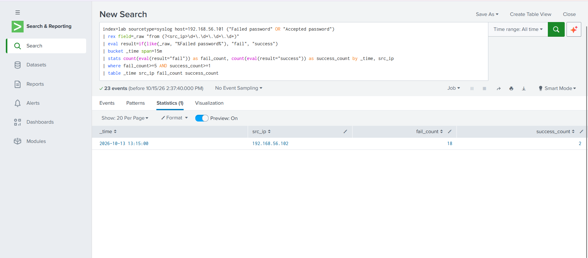
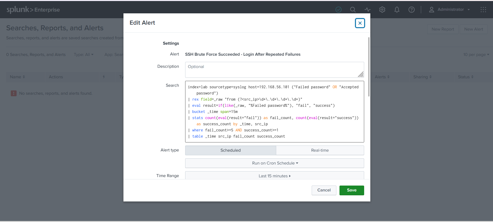
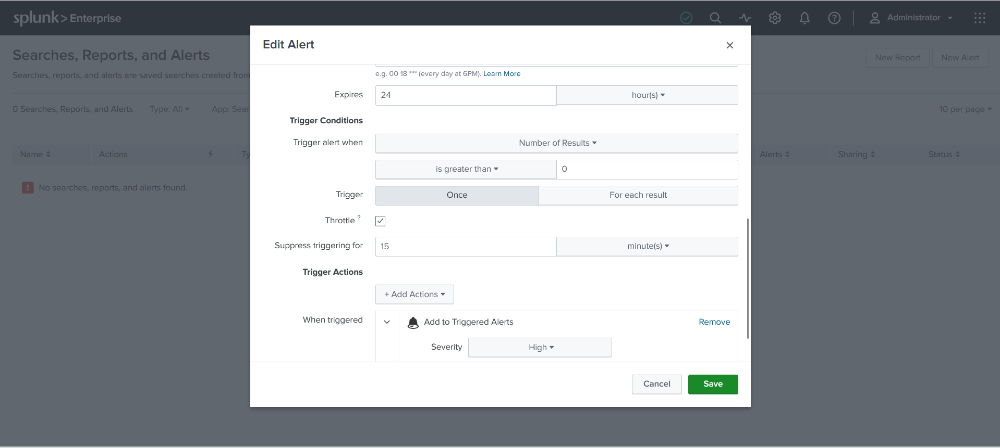
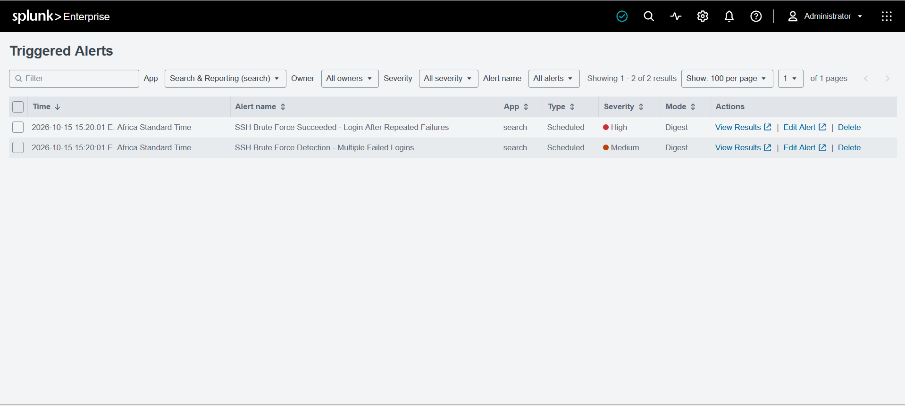
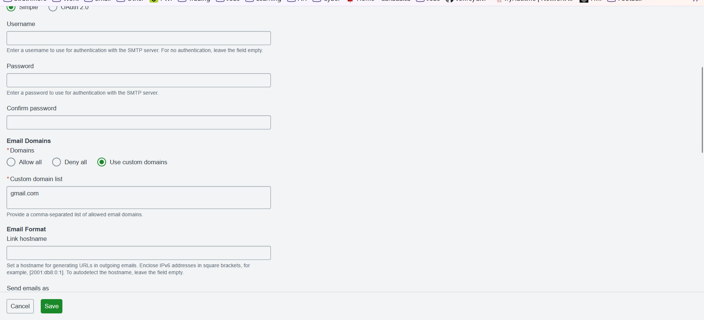

# SOC/SIEM Project: SSH Brute Force Detection with Splunk

## Objective

Simulate an SSH brute force attack against a vulnerable target in an isolated home lab, then build Splunk detections that identify both the attempt and a successful compromise from ingested logs.

## Lab Setup

- **Attacker:** Kali Linux VM, `192.168.56.102`
- **Target:** Metasploitable2 VM, `192.168.56.101`, running an SSH service
- **SIEM:** Splunk Enterprise, running locally and ingesting syslog from the target over UDP 514 into a custom `lab` index

Over a 24-hour window, the `lab` index also held Windows Event Log data from my own machine (Application, Security, System), alongside 508 syslog events from the Metasploitable2 target — confirming the log pipeline was active and indexing correctly before the detection work began.


## Attack Simulation

I confirmed basic SSH connectivity to the target manually, then ran a dictionary attack with Hydra against the default `msfadmin` account using a 10-entry password list:

```
hydra -l msfadmin -P passwords.txt -t 4 ssh://192.168.56.101
```

I ran this twice, about 11 minutes apart. Both runs found the same valid credential (`msfadmin:msfadmin`), which is Metasploitable2's intentionally weak default login. The brute-force burst each run generated also included an `Accepted password` line once the correct password was reached, so the same data supports both detections below.

```
Oct 13 13:26:18 192.168.56.101 sshd[4825]: Failed password for msfadmin from 192.168.56.102 port 35302 ssh2
```


---

## Detection 1: Multiple Failed Logins (Brute Force Attempt)

### Search

```
index=lab sourcetype=syslog "Failed password" host=192.168.56.101
| rex field=_raw "from (?<src_ip>\d+\.\d+\.\d+\.\d+)"
| bucket _time span=1m
| stats count by _time, src_ip
| where count >= 5
```

This extracts the source IP from each failed login line, groups attempts into 1-minute buckets per source IP, and flags any bucket with 5 or more failures.


Run over both attack windows, the search correctly isolated two distinct bursts, one per Hydra run:

| Time | Source IP | Count |
|---|---|---|
| 2026-10-13 13:15:00 | 192.168.56.102 | 9 |
| 2026-10-13 13:26:00 | 192.168.56.102 | 9 |


### Alert configuration

- **Name:** SSH Brute Force Detection - Multiple Failed Logins
- **Type:** Scheduled, cron `*/5 * * * *` (every 5 minutes)
- **Search time range:** Last 15 minutes
- **Trigger condition:** Number of results is greater than 0, trigger Once
- **Throttle:** 15 minutes
- **Trigger action:** Add to Triggered Alerts, **severity Medium**


**Why the throttle was added:** the alert's search window (15 minutes) is wider than its run interval (5 minutes), so a single burst would otherwise sit inside three consecutive scheduled runs and fire three times for one attack. A 15-minute throttle, matched to the search's own lookback, fires once per distinct attack.


The alert ran on schedule, completed with status `success`, and fired correctly when matching failures occurred.


---

## Detection 2: Login Succeeded After Repeated Failures (Confirmed Compromise)

A count of failures alone only shows an attempt. A stronger indicator is a **successful** login immediately following a failure burst from the same source IP — that's evidence the attack actually worked.

### Search

```
index=lab sourcetype=syslog host=192.168.56.101 ("Failed password" OR "Accepted password")
| rex field=_raw "from (?<src_ip>\d+\.\d+\.\d+\.\d+)"
| eval result=if(like(_raw, "%Failed password%"), "fail", "success")
| bucket _time span=15m
| stats count(eval(result="fail")) as fail_count, count(eval(result="success")) as success_count by _time, src_ip
| where fail_count>=5 AND success_count>=1
| table _time src_ip fail_count success_count
```

This matches both failed and accepted SSH login lines, tags each event as `fail` or `success`, groups them into 15-minute buckets per source IP, and keeps only buckets with at least 5 failures *and* at least 1 success in the same window — a brute force that got in.



| Time | Source IP | Failures | Successes |
|---|---|---|---|
| 2026-10-13 13:15:00 | 192.168.56.102 | 18 | 2 |

### Debugging note

My first version of this search used `transaction src_ip maxspan=15m` with `mvfilter(match(_raw,"Failed password"))` to count failures and successes inside each grouped transaction. It consistently returned zero results. The cause: Splunk's `match()` function requires the **entire** field value to match the given pattern, not just contain it — so `match(_raw, "Failed password")` was comparing the whole raw log line (timestamp, hostname, process ID, and all) against the literal string `"Failed password"`, which never matches. The fix was to tag each event's result with `like(_raw, "%Failed password%")` (a proper substring check) in an `eval` before grouping, and to replace the `transaction` + `mvfilter` grouping with a more standard `bucket` + `stats count(eval(...))` pattern. This is a more reliable way to count conditional event types within a time window in SPL.

### Alert configuration

- **Name:** SSH Brute Force Succeeded - Login After Repeated Failures
- **Type:** Scheduled, cron `*/5 * * * *`
- **Search time range:** Last 15 minutes
- **Trigger condition:** Number of results is greater than 0, trigger Once
- **Throttle:** 15 minutes
- **Trigger action:** Add to Triggered Alerts, **severity High** — a confirmed successful compromise is treated as more serious than failures alone





Both alerts fired together on the same scheduled run, correctly distinguishing the two severities side by side:



---

## Hardening: Email Domain Restriction

While reviewing the Splunk instance, I noticed a standing security warning: `allowedDomainList` was empty in `alert_actions.conf`, meaning alert emails could be sent to any domain with no restriction.

**Before:** no value set for `allowedDomainList`, triggering a persistent Splunk security warning on login.

**Fix:** under Settings > Server settings > Email settings > Email Domains, set Domains to "Use custom domains" and added an approved domain to the custom domain list, restricting where alert emails can be sent.



In a real deployment this should be set to the organization's actual approved domain(s) rather than a personal address, but the principle — don't leave an alerting system able to email results anywhere — applies the same way.

---

## Lessons Learned

- **Clock alignment matters for correlation.** Hydra's local timestamps and Splunk's logged timestamps were offset, which first looked like inconsistent data. Comparing the *gap* between the two attack runs in each system (about 11 minutes in both) confirmed it was a fixed clock offset between the Kali VM and the Splunk host, not a data integrity issue — but it's a reminder that time synchronization is a real concern in SOC log correlation, especially when a detection search's window is measured against the SIEM's own clock, not the source machine's.
- **Search window vs. schedule interval interact.** A detection search with a lookback longer than its run interval will re-match the same events on multiple runs unless throttled.
- **`match()` requires a full-string match in SPL**, not a substring check — `like()` with wildcards is the correct tool for "does this field contain X."
- **Default credentials are still a real attack surface.** The entire attack succeeded against Metasploitable2's intentionally weak default account, which is exactly the kind of finding a SOC analyst should expect to catch and escalate.
- **Severity should reflect outcome, not just activity.** Splitting "attempted" (Medium) from "succeeded" (High) into two alerts gives a SOC analyst a clearer signal of what needs immediate attention versus what's background noise.

## Possible Next Steps

- Correlate source IPs across both alerts with a threat intelligence feed or internal watchlist to auto-enrich triggered alerts.
- Add an automated response action (for example, a webhook or script) to the High-severity alert, rather than only logging to Triggered Alerts.
