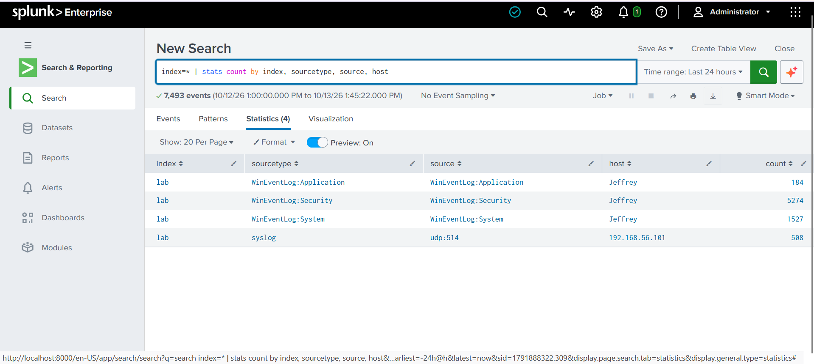
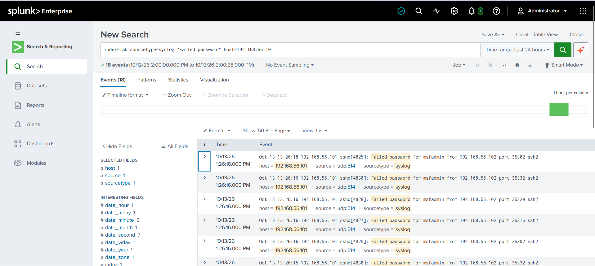
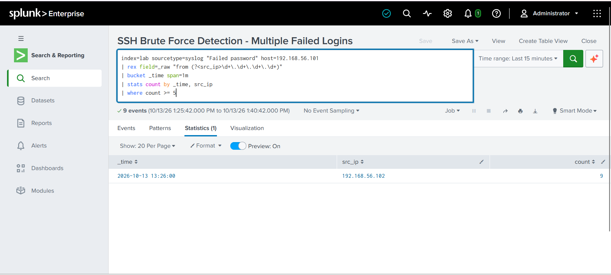
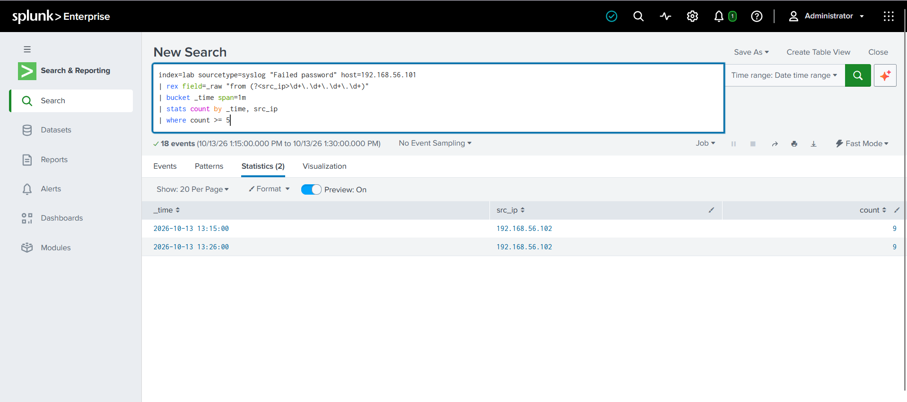
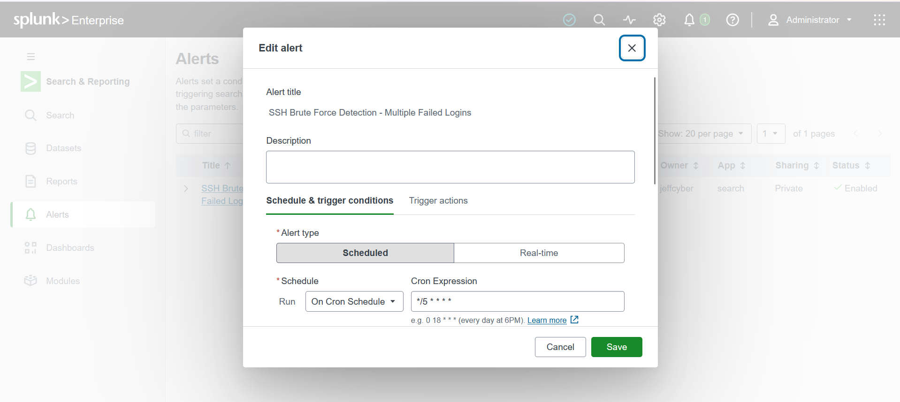
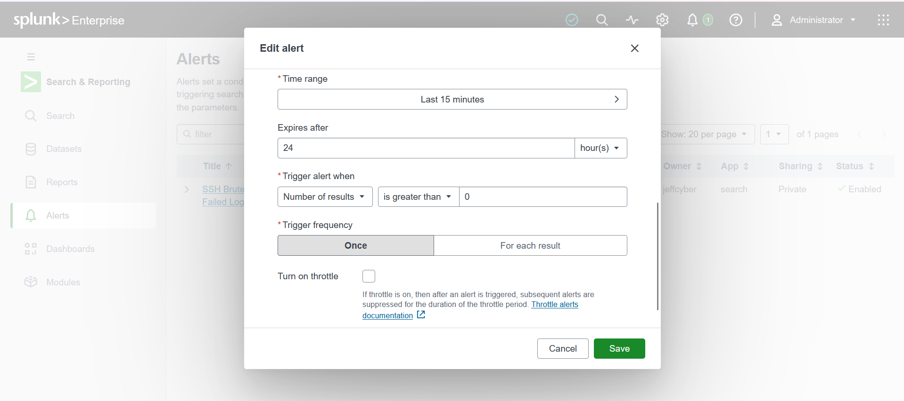
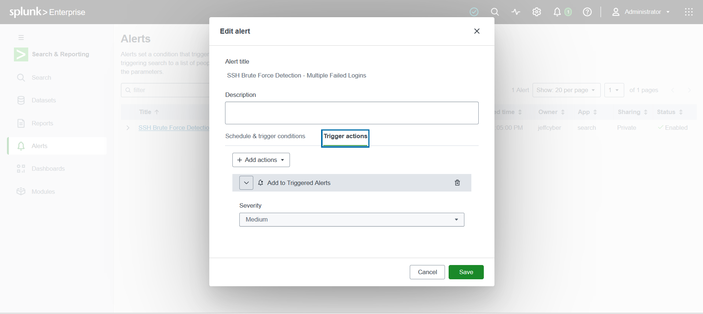
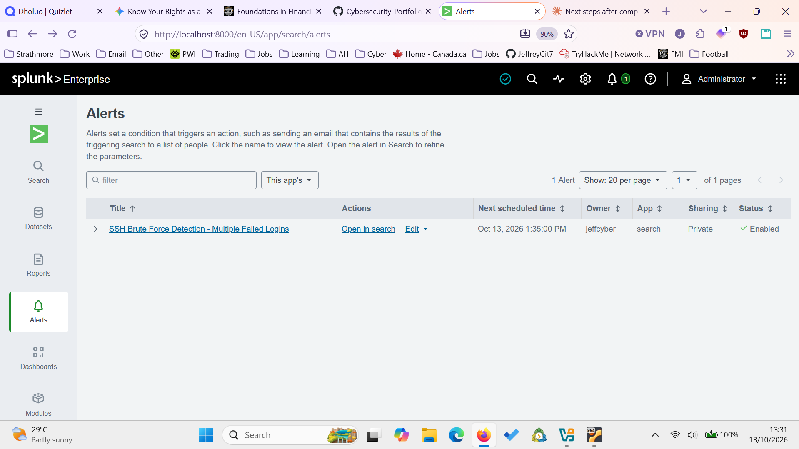
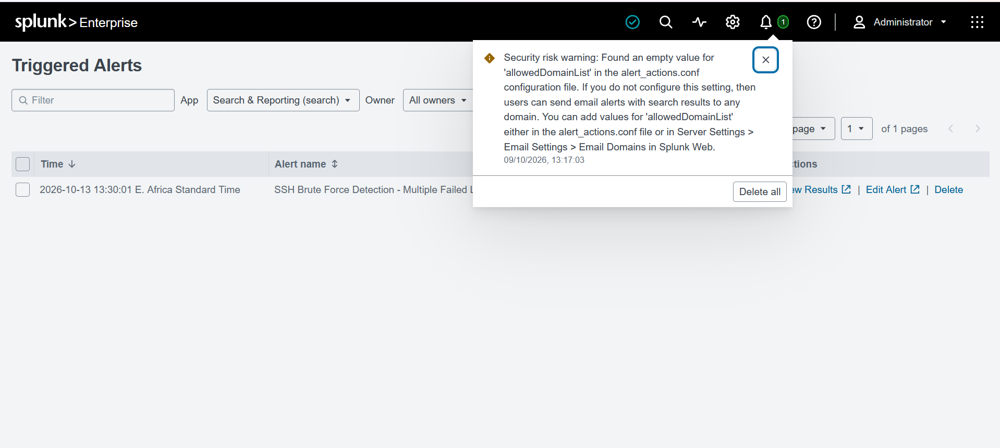
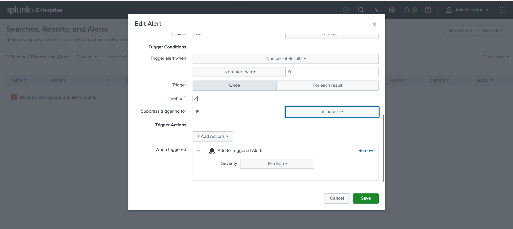

# SOC/SIEM Project: SSH Brute Force Detection with Splunk

## Objective

Simulate an SSH brute force attack against a vulnerable target in an isolated home lab, then build a Splunk detection that identifies the attack from ingested logs and fires an alert.

## Lab Setup

- **Attacker:** Kali Linux VM, `192.168.56.102`
- **Target:** Metasploitable2 VM, `192.168.56.101`, running an SSH service
- **SIEM:** Splunk Enterprise, running locally and ingesting syslog from the target over UDP 514 into a custom `lab` index

Over a 24-hour window, the `lab` index also held Windows Event Log data from my own machine (Application, Security, System), alongside 508 syslog events from the Metasploitable2 target — confirming the log pipeline was active and indexing correctly before the detection work began.



## Attack Simulation

I confirmed basic SSH connectivity to the target manually, then ran a dictionary attack with Hydra against the default `msfadmin` account using a 10-entry password list:

```
hydra -l msfadmin -P passwords.txt -t 4 ssh://192.168.56.101
```

I ran this twice, about 11 minutes apart. Both runs found the same valid credential (`msfadmin:msfadmin`), which is Metasploitable2's intentionally weak default login.

Each run generated a burst of "Failed password" entries in the target's SSH log before the correct password was found, for example:

```
Oct 13 13:26:18 192.168.56.101 sshd[4825]: Failed password for msfadmin from 192.168.56.102 port 35302 ssh2
```



## Detection Logic

Search (SPL):

```
index=lab sourcetype=syslog "Failed password" host=192.168.56.101
| rex field=_raw "from (?<src_ip>\d+\.\d+\.\d+\.\d+)"
| bucket _time span=1m
| stats count by _time, src_ip
| where count >= 5
```

This extracts the source IP from each failed login line, groups attempts into 1-minute buckets per source IP, and flags any bucket with 5 or more failures as a likely brute force attempt.



Run over both attack windows, the search correctly isolated two distinct bursts, one per Hydra run:

| Time | Source IP | Count |
|---|---|---|
| 2026-10-13 13:15:00 | 192.168.56.102 | 9 |
| 2026-10-13 13:26:00 | 192.168.56.102 | 9 |



## Alert Configuration

- **Name:** SSH Brute Force Detection - Multiple Failed Logins
- **Type:** Scheduled, cron `*/5 * * * *` (every 5 minutes)
- **Search time range:** Last 15 minutes
- **Trigger condition:** Number of results is greater than 0
- **Trigger frequency:** Once
- **Throttle:** Suppress re-triggering for 15 minutes
- **Trigger action:** Add to Triggered Alerts, severity Medium







The alert ran on schedule, completed with status `success`, and fired at **13:30:01**, correctly flagging the attack that had occurred a few minutes earlier.





### Why the throttle was added

The alert's search window (15 minutes) is wider than its run interval (5 minutes), so a single burst of failed logins would otherwise sit inside three consecutive scheduled runs and fire three times for one attack. Setting a 15-minute throttle — matched to the search's own lookback window — means the alert fires once per distinct attack, while still catching a genuinely new attack once the throttle period clears.



## Hardening Note

While reviewing the Splunk instance, I noticed a standing security warning (visible in the Triggered Alerts screenshot above): `allowedDomainList` was empty in `alert_actions.conf`, meaning alert emails could be sent to any domain with no restriction. This is a known Splunk hardening item — in a real deployment it should be set under Server Settings > Email Settings > Email Domains, or directly in `alert_actions.conf`, to the organization's approved domain(s).

## Lessons Learned

- **Clock alignment matters for correlation.** Hydra's local timestamps and Splunk's logged timestamps were offset by several hours, which first looked like inconsistent data. Comparing the *gap* between the two attack runs in each system (about 11 minutes in both) confirmed it was a fixed clock offset between the Kali VM and the Splunk host, not a data integrity issue — but it's a reminder that time synchronization is a real concern in SOC log correlation.
- **Search window vs. schedule interval interact.** A detection search with a lookback longer than its run interval will re-match the same events on multiple runs unless throttled.
- **Default credentials are still a real attack surface.** The entire attack succeeded against Metasploitable2's intentionally weak default account, which is exactly the kind of finding a SOC analyst should expect to catch and escalate.

## Next Steps

- Add a second detection for a successful login immediately following a failed-login burst from the same source IP, which is a stronger brute-force-succeeded indicator than failures alone.
- Apply the `allowedDomainList` fix and document the before/after.
