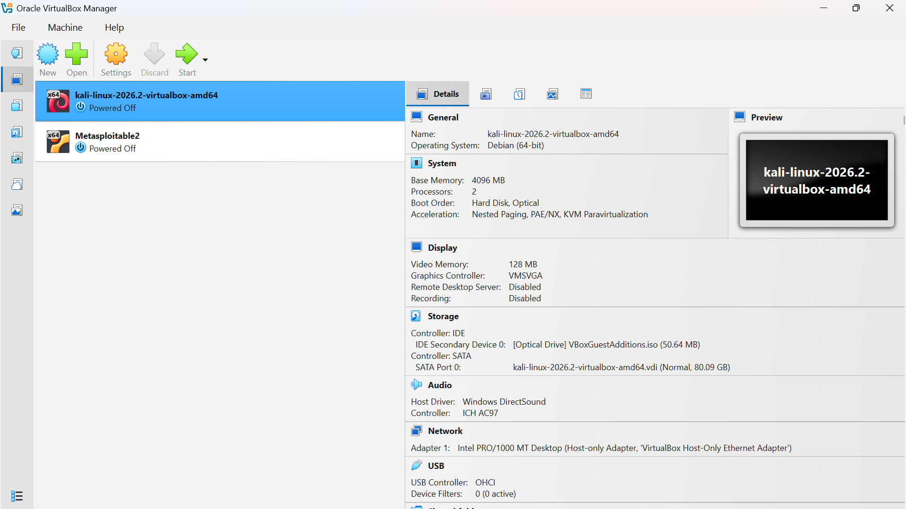
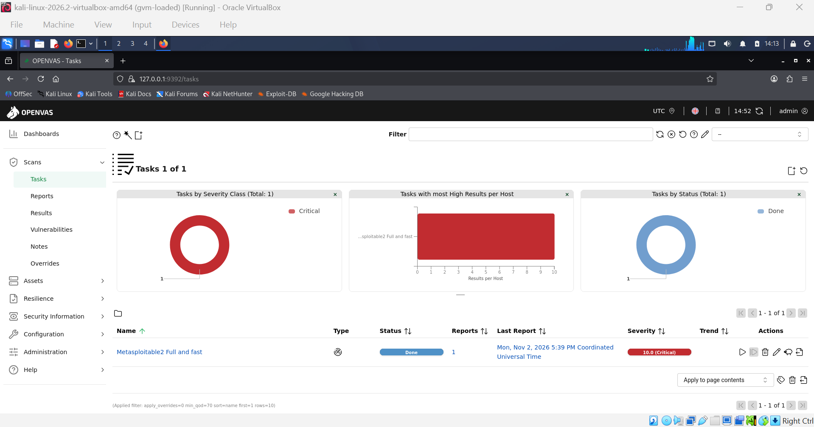
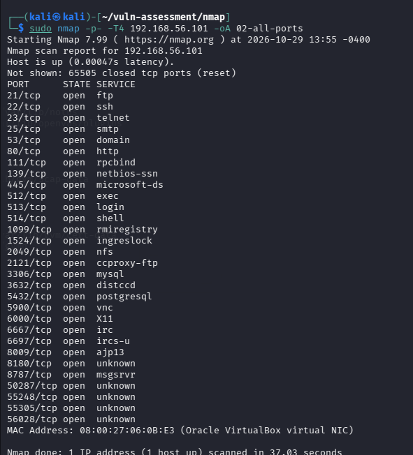
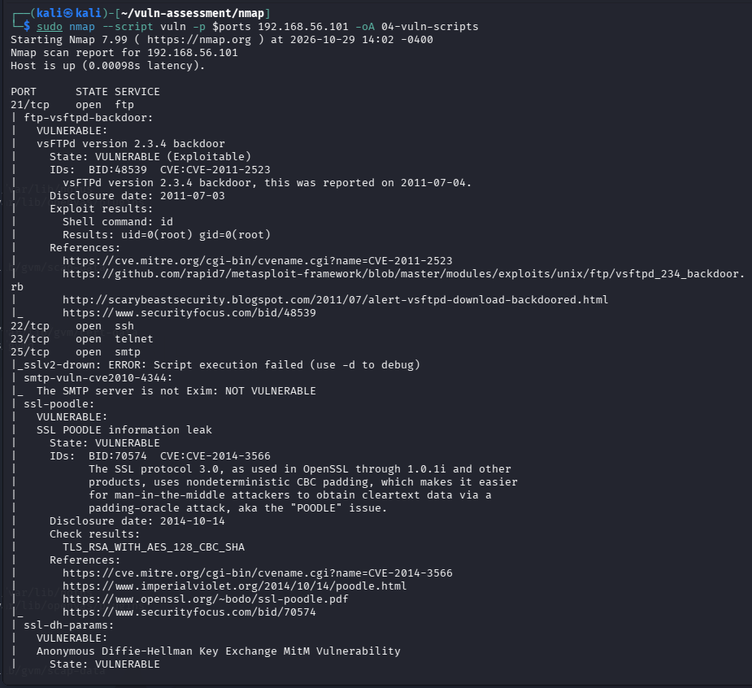
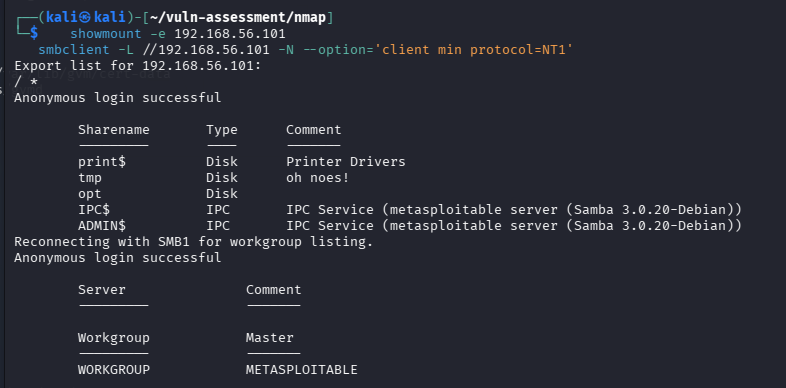

# Vulnerability Assessment: Metasploitable2

**Author:** Jeffrey Odawa
**Target:** Metasploitable2 (192.168.56.101), an intentionally vulnerable Linux VM
**Tools:** Nmap 7.99 and OpenVAS (Greenbone Community Edition) on Kali Linux
**Dates:** Nmap on 29 Oct 2026, OpenVAS on 2 Nov 2026

## Summary

I assessed Metasploitable2 from an isolated lab with Nmap and OpenVAS, and checked a few findings by hand. OpenVAS reported 63 results at a quality of detection (QoD) of 70% or higher: 17 critical, 10 high, 32 medium and 4 low. I merged those with the Nmap and manual results into 31 distinct findings, 27 confirmed and 4 indicated but not verified. The full list is in [findings-log.md](findings-log.md).

What matters most:

1. **The machine can be taken over in several independent ways without a password.** The vsftpd 2.3.4 backdoor, distccd, the Samba usermap script, dRuby, Tomcat's AJP "Ghostcat" flaw and a passwordless root rlogin all gave direct access or command execution in a check.
2. **Almost every service accepts default credentials.** OpenVAS logged in over SSH, both FTP servers, MySQL (root, empty password), PostgreSQL, VNC and Tomcat's management pages.
3. **The foundation is end of life.** The OS is Ubuntu 8.04, unsupported since May 2013. Patching services one by one is not a real fix here. The right answer is to rebuild.
4. **Neither tool was enough alone.** OpenVAS found the credentials and most of the code-execution flaws. Nmap and manual checks found the NFS export of `/`, the SMB null session and deeper TLS problems that OpenVAS's report did not show. Details are in [section 5](#5-nmap-versus-openvas).
5. **There are limits.** The scan was unauthenticated, three OpenVAS checks timed out, and I did not finish importing the CVE and CPE (SCAP) database. See [section 7](#7-limitations).

## 1. Scope and environment

This is my own lab. Only 192.168.56.101 was assessed.

| Item | Detail |
|---|---|
| Network | VirtualBox host-only, 192.168.56.0/24 |
| Target | Metasploitable2, 512 MB RAM. Host-only adapter only, so it has no internet access |
| Scanner | Kali Linux 2026.2, 4 GB RAM, 2 CPUs, 192.168.56.102. A second NAT adapter was added for updates and the OpenVAS feed download only |
| Host | Windows laptop, 8 GB RAM |
| Other hosts seen | 192.168.56.1 (the host adapter), .100 (VirtualBox DHCP) and .102 (Kali itself). All out of scope |



## 2. Method

### 2.1 Nmap (29 Oct 2026)

```bash
sudo nmap -sn 192.168.56.0/24 -oA 01-host-discovery
sudo nmap -p- -T4 192.168.56.101 -oA 02-all-ports
sudo nmap -sV -sC -O -p $ports 192.168.56.101 -oA 03-service-detail
sudo nmap --script vuln -p $ports 192.168.56.101 -oA 04-vuln-scripts
```

`$ports` is the list of open ports from scan 2. The all-ports scan found 30 open TCP ports in 37 seconds, the service scan took about 141 seconds, and the vulnerability scripts took about 327 seconds. Scan 3 ran against open ports only, so Nmap warned that its OS guess (Linux 2.6.x) was unreliable. I used OpenVAS's OS detection instead.

### 2.2 Manual checks

```bash
showmount -e 192.168.56.101
smbclient -L //192.168.56.101 -N --option='client min protocol=NT1'
```

### 2.3 OpenVAS (2 Nov 2026)

| Setting | Value |
|---|---|
| Scan config | Full and fast (191,201 vulnerability tests) |
| Port list | All TCP and Nmap top 100 UDP |
| Scanner | OpenVAS Default |
| Concurrency | 4 tests per host, 20 hosts (defaults) |
| Credentials | None, so the scan was unauthenticated |
| Run time | 17:39 to 19:00 UTC, 1 hour 20 minutes |
| Report filter | QoD 70% or higher, log-level results hidden: 63 of 701 results |

The vulnerability test feed was dated 29 Oct 2026 and showed as 4 days old at scan time ([screenshot 08](screenshots/08-feed-status.png)).



### 2.4 Confirmed or indicated, and how I rated

A finding is **confirmed** when a scan result or direct check demonstrated it: a command ran, a login worked, or a service answered in the vulnerable way. It is **indicated** when the evidence is a banner, a version or a fingerprint, or when the check did not complete.

**Ratings are mine.** They reflect impact and ease of exploitation on this host. Where OpenVAS's CVSS score differs, I say so.

**The active checks were not passive.** I did no manual exploitation and deployed no payloads. But the tools' checks ran harmless commands (`id`, `ping`, `cat /etc/passwd`), logged in with default accounts, and uploaded and deleted a test file over WebDAV. This is an assessment, not a penetration test.

## 3. Results at a glance

| OpenVAS severity | Results |
|---|---|
| Critical | 17 |
| High | 10 |
| Medium | 32 |
| Low | 4 |
| **Total (QoD 70% or higher)** | **63** |

OpenVAS also reported 1 host, 20 ports with results (of 30 open), 21 applications, 1 OS and 172 CVEs referenced. 29 of the 63 results came from checks with QoD 95% or higher, which are active checks or direct remote analysis and not version matches.



## 4. Key findings

### 4.1 Backdoors and direct code execution

| Finding | Port | Evidence |
|---|---|---|
| vsftpd 2.3.4 backdoor (CVE-2011-2523) | 21, 6200 | Nmap's script ran `id` and returned root. OpenVAS flagged 21 and 6200 |
| distccd command execution (CVE-2004-2687) | 3632 | `id` returned the daemon user in both tools |
| Samba usermap script (CVE-2007-2447) | 445 | OpenVAS made the target ping the scanner |
| dRuby remote syscalls | 8787 | OpenVAS got a syscall response from the service |
| Tomcat AJP "Ghostcat" (CVE-2020-1938) | 8009 | OpenVAS read `/WEB-INF/web.xml` through AJP |
| Java RMI default configuration (CVE-2011-3556) | 1099, 50136 | The target connected back to the scanner on both ports |
| rlogin passwordless root login | 513 | OpenVAS got root without a password |



Samba is a good example of why ratings need judgement. OpenVAS scores it 6.0, but its check proved unauthenticated command execution on the host, so I rate it Critical.

### 4.2 Default credentials

OpenVAS logged in with default accounts on SSH, FTP (ports 21 and 2121), MySQL (root, empty password), PostgreSQL (postgres), VNC (a trivially guessable password) and Tomcat's Manager, Host Manager, Server Status and Admin pages. Four accounts (msfadmin, postgres, service, user) worked on SSH and both FTP servers, and over SSH OpenVAS ran `cat /etc/passwd`. I have redacted the passwords. Default credentials are the cheapest attack there is, and here they cover almost every service.

### 4.3 Exposed file systems and remote-login services

- **NFS exports `/` to everyone.** `showmount` shows the whole root filesystem exported to any host (`*`). It lists paths and allowed clients, not options, so I did not test write access or root squashing.
- **SMB allows a null session.** Anonymous login lists five shares, the server only speaks SMB1 (I had to allow SMB1 in `smbclient`), and message signing is disabled.
- **Cleartext remote login:** telnet, rexec, rlogin and rsh are all running.



### 4.4 The web stack

Apache 2.2.8 serves old applications: TWiki, TikiWiki, phpMyAdmin, DVWA and Mutillidae. OpenVAS confirmed that WebDAV allows PUT and DELETE (it uploaded a test file and deleted it) and that PHP-CGI is vulnerable to argument injection (CVE-2012-1823). The rest is information disclosure and old components: TRACE enabled, `phpinfo.php` exposed, outdated jQuery, XSS and CSRF in several apps, a directory traversal and a local file inclusion.

### 4.5 TLS

Nmap found the most depth on SMTP: SSLv2 with weak ciphers, POODLE, Logjam with 512-bit export Diffie-Hellman, anonymous Diffie-Hellman and an expired certificate (2010). PostgreSQL has CCS injection (CVE-2014-0224), POODLE, old protocol versions and weak keys, and both tools agree on that one. OpenVAS's own TLS detection timed out, so Nmap is the main source for TLS here.

### 4.6 An end-of-life foundation

OpenVAS identified the OS as Ubuntu 8.04, end of life since 9 May 2013, and rated that finding 10.0. Nmap's version detection showed the same age across the service stack: Apache 2.2.8, OpenSSH 4.7p1, BIND 9.4.2, MySQL 5.0.51a, PostgreSQL 8.3, ProFTPD 1.3.1 and Tomcat 5.5. The service versions are version-based findings (indicated), but the OS end-of-life is confirmed.

### 4.7 Indicated but not verified

- **Port 1524:** Nmap fingerprinted a bind shell. OpenVAS's Ingreslock check timed out, so I cannot call it confirmed.
- **UnrealIRCd (6667, 6697):** the version is unknown. Nmap's script was throttled by the server and OpenVAS reported nothing at QoD 70% or higher. The backdoored 3.2.8.1 build is neither confirmed nor ruled out.
- **TWiki:** OpenVAS detected an old version (QoD 80) and rated it 10.0, but the reported version string reads `01.Feb.2003`, which is a release date, so I treat it as unverified.

## 5. Nmap versus OpenVAS

Neither tool covers the other's gaps.

| | Findings |
|---|---|
| **Both tools agreed** | vsftpd backdoor, distccd, Java RMI, anonymous FTP, TRACE, `phpinfo.php`, SMTP VRFY, PostgreSQL TLS problems, cleartext remote-login services |
| **Only OpenVAS** | Default credentials on six services, Samba command execution (Nmap saw the version only), dRuby, Ghostcat, passwordless rlogin, WebDAV write access, PHP-CGI, outdated web apps, weak SSH algorithms, OS end of life, the second RMI port (50136) |
| **Only Nmap or manual checks** | NFS export of `/`, SMB null session and SMB1, deeper SMTP TLS problems (SSLv2, Logjam), the full service and version inventory, the bind shell fingerprint, Tomcat cookies without HttpOnly |

"Only" here means it was not among OpenVAS's 63 results at QoD 70% or higher. A lower-confidence result could exist in the hidden 638.

**Checks that were wrong or misleading:**

- **EasyPHP finding on a Linux host.** OpenVAS flagged "EasyPHP Webserver <= 12.1" at `/phpinfo.php`. EasyPHP is a Windows package, so the product name does not apply. The exposed `phpinfo.php` underneath is real and Nmap found it too.
- **Riello NetMan check name.** OpenVAS's SSH default-credentials check is named after a UPS card product. The host is not one, but the check logged in with a default account and ran a command, so the underlying problem is real.
- **Severity oddities.** The Samba flaw scores 6.0 while the rexec service detection scores 10.0. The first proved command execution and the second only detected a running service.

## 6. What I would fix first

1. **Rebuild instead of patching.** Ubuntu 8.04 has been unsupported since 2013. Until a rebuild, keep the machine off any network that matters.
2. **Remove backdoors and unauthenticated code execution:** vsftpd 2.3.4, the port 1524 listener, UnrealIRCd, distccd, dRuby, Java RMI, and the r-services (rexec, rlogin, rsh).
3. **Fix every default credential:** the SSH and FTP accounts, MySQL root, PostgreSQL, VNC and Tomcat. Bind databases to localhost.
4. **Lock down file sharing:** stop exporting `/` over NFS, disable SMB null sessions and SMB1, and require signing.
5. **Patch or remove exposed software:** Samba, Tomcat (and AJP), PHP-CGI, TWiki, phpMyAdmin and the test content. Disable WebDAV write methods and TRACE.
6. **Replace cleartext protocols:** telnet and FTP with SSH and SFTP.
7. **Fix TLS:** disable SSLv2, SSLv3 and TLS 1.0/1.1, remove export and anonymous suites, use 2048-bit Diffie-Hellman groups or larger, and issue new certificates.

## 7. Limitations

- **Unauthenticated scan.** OpenVAS had no credentials, so it did not check patch levels from inside the host.
- **Single run.** One Nmap pass and one OpenVAS scan, each at one point in time.
- **Feed data.** The OpenVAS tests were dated 29 Oct and 4 days old at scan time. I did not finish importing the SCAP (CVE and CPE) database, so the web interface's CVE and CPE browsing pages are empty and EPSS shows N/A. Severities and CVE references in the report still come through, because they come from the tests themselves.
- **Three timeouts.** SSL/TLS Version Detection (320 s), Possible Backdoor: Ingreslock (320 s) and the Log4Shell active check (900 s) timed out. Log4j was not verified, and OpenVAS's TLS coverage is incomplete.
- **Hidden results.** The default filter shows 63 of 701 results. The other 638 are log-level or lower-confidence entries that I did not review.
- **Nmap scope.** All TCP ports were scanned but no UDP. OpenVAS covered the top 100 UDP ports.
- **Not a penetration test.** I did no manual exploitation and did not test write access to the NFS export.
- **A deliberately vulnerable target.** Real systems will not look like this. The value of the exercise is the process and how the two tools compare.

## 8. Lab notes: problems I hit

1. **Kali had no internet.** Both VMs were on a host-only network, so `apt` failed ([03a](screenshots/03a-troubleshooting-no-internet.png)). I added a NAT adapter to Kali only, and kept Metasploitable2 isolated ([03b to 03d](screenshots/03d-network-fix-ip-and-ping.png)).
2. **The OpenVAS feed sync timed out and then hung when my laptop slept.** I disabled sleep and re-ran `greenbone-feed-sync` ([03e](screenshots/03e-feed-sync-timeout.txt), [05](screenshots/05-feed-sync-complete.png)).
3. **gvmd was killed by the kernel's out-of-memory killer** while importing 191,215 tests on a 4 GB VM. A 4 GB swap file fixed it, and the import completed ([09a](screenshots/09a-db-check-no-configs-or-nvts.png), [09b](screenshots/09b-ospd-vts-loaded.png)).
4. **I stopped the SCAP import** because it was the heaviest step and the scan does not need it. Feed Status shows no SCAP row ([08](screenshots/08-feed-status.png)).

## 9. Evidence index

Raw tool output is kept in `evidence/nmap/`: `01-host-discovery`, `02-all-ports`, `03-service-detail` and `04-vuln-scripts`, each as `.nmap`, `.xml` and `.gnmap`. The OpenVAS CSV and PDF exports stay local and are not published, because they contain the target's default credentials in plain text. [openvas-results-appendix.md](openvas-results-appendix.md) lists every result without that detail.

| Screenshots | What they show |
|---|---|
| 01a, 01b | VM settings for Metasploitable2 and Kali |
| 02 | Pre-flight checks: connectivity, RAM, disk |
| 03a to 03e | The no-internet problem and its fix; the feed sync timeout |
| 04a to 04c | IP addresses and connectivity checks after a restart |
| 05, 06 | Feed sync complete; `gvm-check-setup` passed |
| 08, 08a, 08b | Feed status (final and while loading); NVTs page waiting for SCAP |
| 09a, 09b | Database check with no configs; scanner finished loading tests |
| 10 | Scan configs, including Full and fast |
| 11a to 11c | Target: list, form and no credentials |
| 12a to 12c | Task form, settings and created task |
| 13a, 13b | Scan running at 2%; scan finished, top severity 10.0 |
| 14a to 14c | Report information, top results, and the three error messages |
| N1, N2 | Nmap host discovery and all-ports scan |
| N3a to N3c | Nmap service and version detection |
| N4a to N4f | Nmap vulnerability scripts |
| N5 | `showmount` and `smbclient` output |
| extras/ | Extra captures kept for reference |
